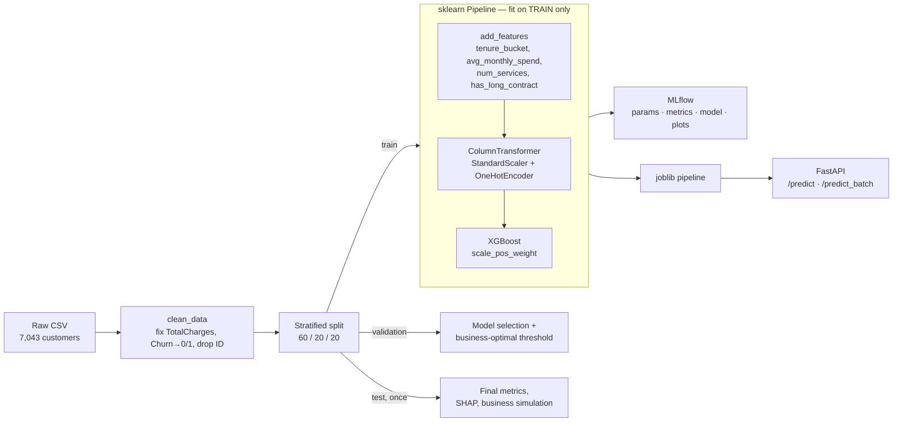
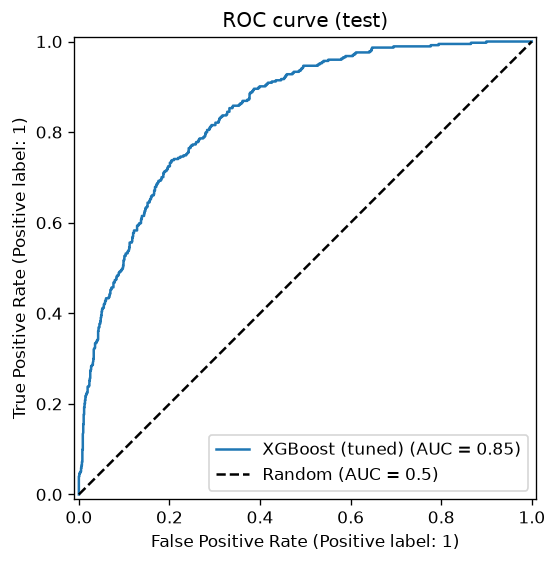
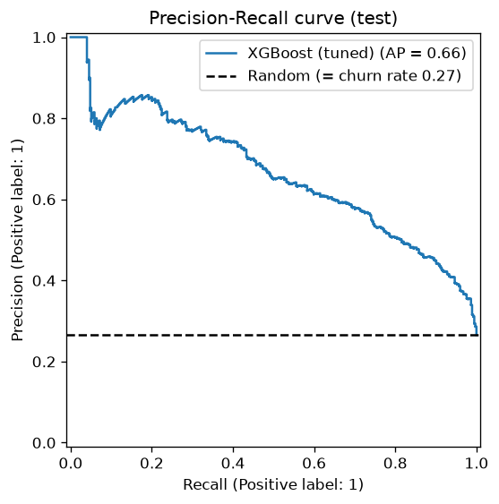
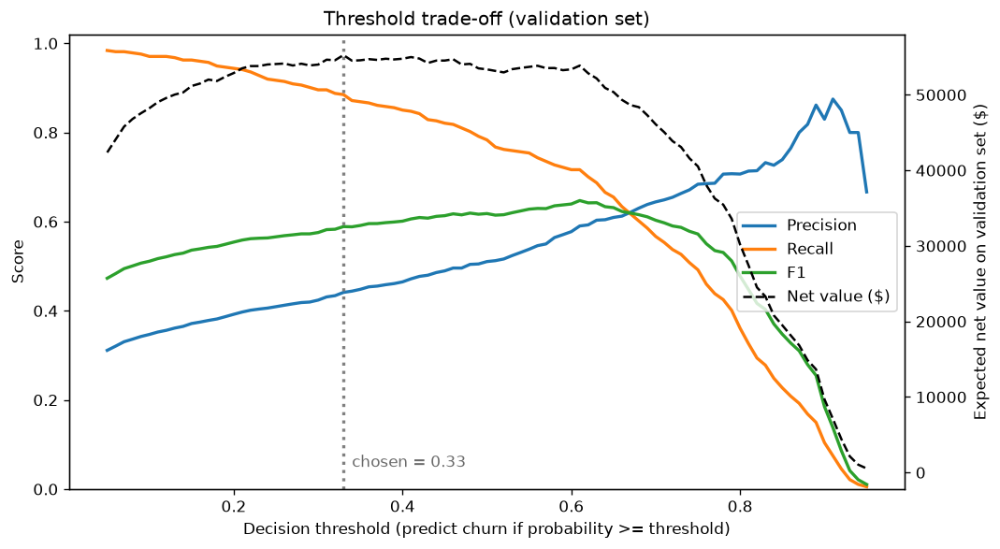
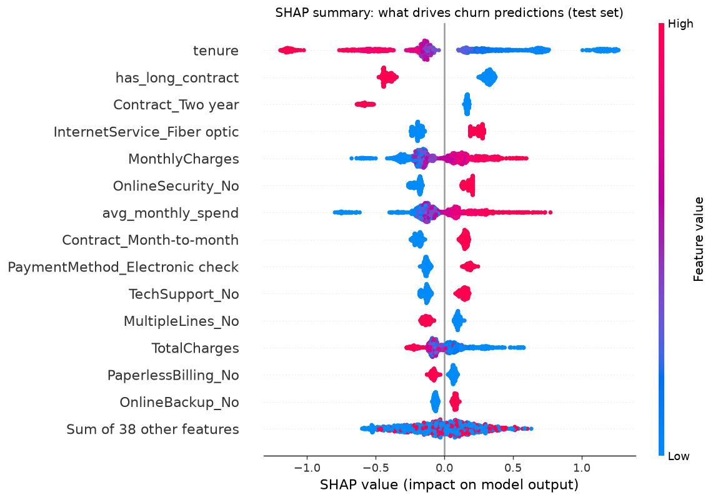
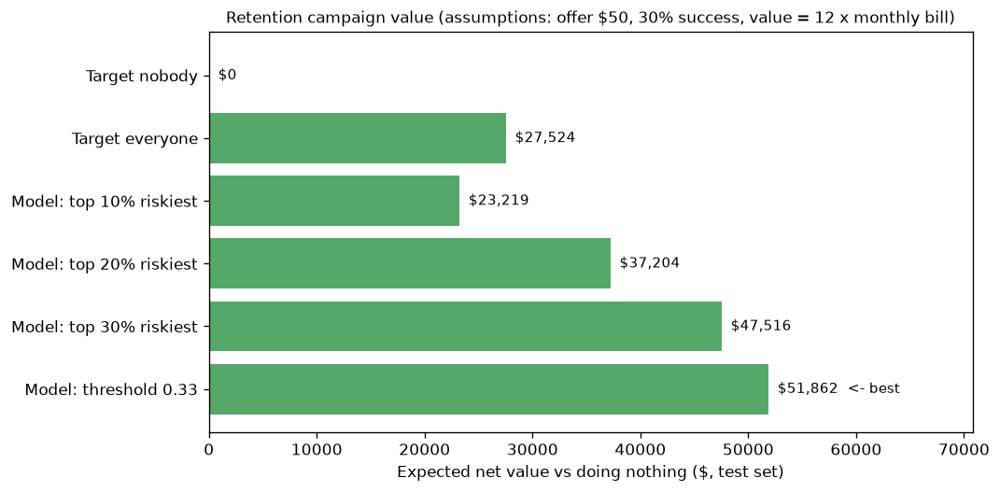

# Customer Churn Prediction — from raw data to a business decision and an API

> Predicts which telecom customers are about to leave, explains **why** with SHAP, turns the
> predictions into a retention strategy worth **~$51.9k on 1,409 held-out customers** (under stated
> assumptions), and serves it all through a FastAPI endpoint.

   

📄 **Full write-up:** [reports/churn_report.pdf](reports/churn_report.pdf) (10-page detailed report, all numbers generated by the code).

---

## 1. Business problem

A subscription business loses revenue every time a customer cancels ("churns"). Keeping an existing
customer is much cheaper than acquiring a new one, but retention offers cost money, so we cannot send
them to everyone. The question is:

**Which customers should receive a retention offer so that the money saved is larger than the money spent?**

This project answers it with a churn-probability model, an explanation of the drivers, and a
cost/benefit simulation that picks the targeting strategy.

## 2. Dataset

[IBM Telco Customer Churn](https://github.com/IBM/telco-customer-churn-on-icp4d): **7,043 customers,
21 columns**: demographics, account info (tenure, contract, payment method, charges) and subscribed
services. Target: `Churn` (Yes/No), **26.5% positive**, so the classes are imbalanced.

Data quality issues found in the EDA: `TotalCharges` is stored as text and has **11 blank values**, all for
customers with `tenure = 0` (not billed yet). These are set to 0. There are no duplicated customer IDs.

## 3. Approach



| Step | What | Why |
|---|---|---|
| EDA | [notebooks/01_eda.ipynb](notebooks/01_eda.ipynb) | Find data issues and churn drivers before modeling |
| Features | [src/features.py](src/features.py) | 4 business-driven features; one `Pipeline` so training and API preprocess the same way |
| Split | Stratified 60/20/20 | Train / choose model + threshold / honest final estimate |
| Models | Dummy → Logistic Regression (balanced) → XGBoost + `RandomizedSearchCV` (30 candidates × 5-fold, ROC-AUC) | Start simple and only add complexity when it beats the baseline |
| Tracking | MLflow (local SQLite) | Every run's params, metrics, model and plots are reproducible |
| Threshold | Maximise expected net value on **validation** | The business cost of errors decides the threshold, not 0.5 |
| Explainability | SHAP TreeExplainer | Global drivers + per-customer reasons (also returned by the API) |

**Engineered features and their business reasons**

| Feature | Definition | Business reason |
|---|---|---|
| `tenure_bucket` | 0-1y / 1-2y / 2-4y / 4y+ | Churn is 47% in year 1 vs 10% after 4 years, and the drop is not linear |
| `avg_monthly_spend` | TotalCharges / tenure (current bill if tenure = 0) | Compared with today's bill, shows whether the price went up |
| `num_services` | count of subscribed services | More services means higher switching cost and more "lock-in" |
| `has_long_contract` | 1 if one- or two-year contract | Commitment is the strongest single signal in the EDA |

## 4. Results

**Model comparison (validation set, threshold 0.5)**

| Model | CV ROC-AUC (train, 5-fold) | ROC-AUC | PR-AUC | Precision | Recall | F1 | Accuracy |
|---|---|---|---|---|---|---|---|
| Dummy (always "no churn") | 0.500 | 0.500 | 0.265 | 0.000 | 0.000 | 0.000 | **0.735** |
| Logistic Regression (balanced) | 0.849 | 0.837 | **0.649** | 0.512 | 0.786 | 0.620 | 0.745 |
| **XGBoost (tuned)** ✅ | **0.849** | **0.839** | 0.645 | 0.510 | 0.783 | 0.618 | 0.743 |

*Why accuracy is misleading:* the dummy model scores **73.5% accuracy while catching zero churners**.
With 26.5% positives, accuracy rewards ignoring the class we care about. ROC-AUC (ranking quality) and
PR-AUC (precision/recall on the churn class, baseline = 0.265) measure what matters.

*Honest note:* XGBoost and Logistic Regression are practically tied (+0.002 ROC-AUC). XGBoost was kept
because it was the pre-defined selection metric, but on this small, mostly categorical dataset a linear model is
just as good. That is a common real-world result and a valid argument for the simpler model.

**Final test-set performance (XGBoost, n = 1,409, scored once)**

| Threshold | ROC-AUC | PR-AUC | Precision | Recall | F1 | Accuracy |
|---|---|---|---|---|---|---|
| 0.50 (default) | 0.846 | 0.664 | 0.507 | 0.789 | 0.617 | 0.740 |
| **0.33 (business-optimal, chosen on validation)** | 0.846 | 0.664 | 0.451 | **0.896** | 0.600 | 0.683 |

At 0.33 the model catches **335 of 374 churners (89.6%)**. Confusion matrix: TN=628, FP=407, FN=39, TP=335.

*Why 0.33 and not 0.5?* An offer costs $50, while sending it to a real churner is worth on average
0.30 × $873 (12 × their ~$73 monthly bill on the test set) ≈ $262. A missed churner costs much more than a wasted offer, so it pays to accept more
false positives in exchange for higher recall. The net-value curve is flat between about 0.25 and 0.6,
so the decision is robust to the exact threshold.

| ROC | Precision-Recall | Threshold trade-off |
|---|---|---|
|  |  |  |

*Calibration:* the model **over-estimates** probabilities (e.g. a predicted 0.6 corresponds to about 0.3
observed churn) because `scale_pos_weight` re-weights the classes. This does not hurt ranking or the
threshold, which was tuned on real outcomes. If calibrated probabilities are needed, add
`CalibratedClassifierCV` (see next steps). Brier score: 0.163.

## 5. Key SHAP insights



Top drivers (mean |SHAP|): **tenure**, **has_long_contract**, **Contract_Two year**,
**InternetService_Fiber optic**, **MonthlyCharges**, **OnlineSecurity_No**.

In plain English for a manager:
1. **New customers are the biggest risk.** The first months decide everything. Risk falls steadily the longer a customer stays.
2. **Contracts protect us.** Customers on one- or two-year contracts rarely leave, so converting month-to-month customers is the strongest lever.
3. **Fiber optic customers with high bills are unhappy.** Fiber pushes risk up even after accounting for price, which suggests a price or quality problem with that product.
4. **Security and tech-support add-ons go with loyalty.** Customers without them churn more, so bundling them into a retention offer makes sense.
5. **Paying by electronic check is a warning sign.** Moving customers to automatic payment is a cheap action.

Example: test customer #1090 (predicted 96%, really churned) is high risk mainly because
`tenure = 1`, no long contract and fiber internet ([waterfall plot](reports/figures/shap_waterfall_customer.png)).

## 6. Business simulation

**Assumptions** (in [src/config.py](src/config.py)): customer value = monthly charges × 12; offer cost =
$50 per targeted customer; 30% of targeted churners are saved. Net value is measured against doing nothing.

| Strategy (test set, 1,409 customers) | Targeted | Churners reached | Cost | Expected saved | **Net value** |
|---|---|---|---|---|---|
| Target nobody | 0 | 0 (0%) | $0 | $0 | $0 |
| Target everyone | 1,409 | 374 (100%) | $70,450 | $97,974 | $27,524 |
| Model: top 10% riskiest | 141 | 109 (29%) | $7,050 | $30,269 | $23,219 |
| Model: top 20% riskiest | 282 | 185 (49%) | $14,100 | $51,304 | $37,204 |
| Model: top 30% riskiest | 423 | 251 (67%) | $21,150 | $68,666 | $47,516 |
| **Model: threshold 0.33** | 742 | 335 (90%) | $37,100 | $88,962 | **$51,862** |
| *Perfect knowledge (upper bound)* | 374 | 374 (100%) | $18,700 | $97,974 | *$79,274* |



**Recommendation:** target customers with predicted risk ≥ 0.33. It brings **1.9× the value of
targeting everyone** for about half the budget, and captures **65% of the theoretical maximum**. If the
budget is capped, "top 30%" is the best fixed-size campaign ($47.5k).

## 7. How to run

```powershell
# Windows PowerShell (macOS/Linux: source .venv/bin/activate, or use the Makefile)
python -m venv .venv
.\.venv\Scripts\Activate.ps1
pip install -r requirements.txt

python -m src.data        # download dataset (if it fails: get "Telco Customer Churn" from Kaggle -> data/raw/)
python -m src.train       # ~2 min: 3 models, MLflow logging, saves models/churn_pipeline.joblib
python -m src.evaluate    # threshold on validation + final test metrics & plots
python -m src.explain     # SHAP plots
python -m src.business    # strategy simulation
python -m src.report      # PDF report (reports/churn_report.pdf)
pytest                    # 15 tests
uvicorn api.main:app --reload    # API at http://127.0.0.1:8000/docs
mlflow ui --backend-store-uri sqlite:///mlflow.db   # experiment UI at http://127.0.0.1:5000
```

With `make`: `make setup`, `make pipeline` (train → evaluate → explain → business → report), `make test`, `make serve`, `make mlflow`.
Re-run the EDA notebook with `make eda`, or open `notebooks/01_eda.ipynb` in Jupyter / VS Code.

## 8. API usage

Endpoints: `GET /health`, `POST /predict` (one customer), `POST /predict_batch` (up to 1,000).
Inputs are validated by Pydantic. A wrong category or a negative tenure returns **HTTP 422** with a clear message.
Open **http://127.0.0.1:8000/docs**, click an endpoint, then **Try it out**. The example body is pre-filled; click **Execute**.

```bash
curl http://127.0.0.1:8000/health
# {"status":"ok","model":"XGBoost (tuned)","threshold":0.33}

curl -X POST http://127.0.0.1:8000/predict -H "Content-Type: application/json" -d '{
  "gender":"Female","SeniorCitizen":0,"Partner":"No","Dependents":"No","tenure":2,
  "PhoneService":"Yes","MultipleLines":"No","InternetService":"Fiber optic",
  "OnlineSecurity":"No","OnlineBackup":"No","DeviceProtection":"No","TechSupport":"No",
  "StreamingTV":"Yes","StreamingMovies":"No","Contract":"Month-to-month",
  "PaperlessBilling":"Yes","PaymentMethod":"Electronic check",
  "MonthlyCharges":85.5,"TotalCharges":171.0}'
```
Real response:
```json
{"churn_probability":0.9039,"churn_prediction":1,"risk_level":"high",
 "top_reasons":[
   {"feature":"tenure = 2","shap_value":0.729,"effect":"increases churn risk"},
   {"feature":"has_long_contract = 0","shap_value":0.3529,"effect":"increases churn risk"},
   {"feature":"InternetService = Fiber optic","shap_value":0.2694,"effect":"increases churn risk"}]}
```
Batch: `POST /predict_batch` with `{"customers": [ {...}, {...} ]}`.
Risk levels: low < 0.30 ≤ medium < 0.60 ≤ high. `churn_prediction` uses the business threshold (0.33).

> PowerShell note: `curl` is an alias there. Use `curl.exe`, or `Invoke-RestMethod`, or the `/docs` page.

## 9. Project structure

```
churn-prediction/
├── data/raw/, data/processed/   # git-ignored; processed = saved train/valid/test splits
├── notebooks/01_eda.ipynb       # EDA + "Key insights"
├── src/
│   ├── config.py      # paths, seed, columns, business ASSUMPTIONS
│   ├── data.py        # download, load, clean, split
│   ├── features.py    # feature engineering + preprocessing Pipeline
│   ├── train.py       # Dummy / LogReg / XGBoost + MLflow, saves best pipeline
│   ├── evaluate.py    # metrics, threshold analysis, test-set plots
│   ├── explain.py     # SHAP (also used by the API)
│   ├── business.py    # cost/benefit simulation
│   └── report.py      # builds the PDF report from saved results
├── api/main.py        # FastAPI app
├── models/            # git-ignored: pipeline, SHAP background, metadata (threshold)
├── reports/           # figures + CSV/JSON results + PDF report
├── tests/             # pytest: data, features, model, API
├── Makefile, pytest.ini, requirements.txt
```

## 10. Limitations and next steps

**Limitations**
- **Static snapshot.** There are no timestamps, so we cannot do a time-based split or know *when* a customer will churn.
- **Assumed economics.** The business numbers depend on the $50 / 30% / 12-month assumptions. The real offer success rate must be measured with an A/B test.
- **Uplift isn't modelled.** We predict *who will churn*, not *who will respond to an offer*. Some high-risk customers can't be saved, and some would have stayed anyway.
- **Probabilities are not calibrated** (see section 4).
- **Small dataset (7k rows).** Results have variance: the XGBoost vs LogReg difference is within noise.

**Next steps**
- Calibrate probabilities (`CalibratedClassifierCV`, isotonic) so the API returns true probabilities.
- Retrain the final model on train + validation before deployment.
- Package with **Docker** and add CI (GitHub Actions running `pytest`).
- **Monitoring:** log predictions, track input **data drift** (e.g. PSI per feature with Evidently) and the live churn rate. Retrain on a schedule or when drift crosses a threshold.
- Register models in the MLflow Model Registry and promote them via staging → production.
- Run an A/B test of the retention campaign to measure the real success rate, then move to **uplift modelling**.
